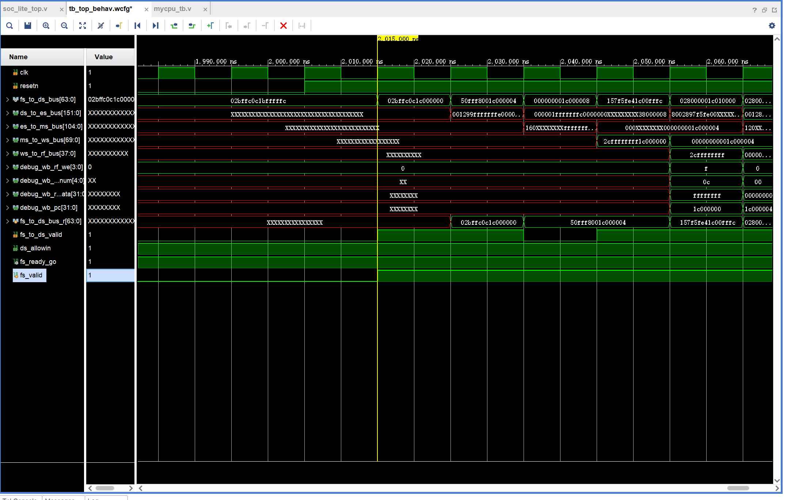

# 一些开发日志罢大抵
## 2026.9.13
### 进度
- 基本部署起来了开发环境，可以进行愉快的编程了。
### 补充说明
1. 测试文件的逻辑是检测debug_rf_we信号是否使能，即判断是否有写寄存器，所以不用区分单总线和单周期
2. 写入内存的操作不会被当周期直接发现，而是在载入寄存器时发现问题。
3. 缓冲区设计方法：根据上一级传进来的bus剔除掉在本阶段要使用的信号，添加下一阶段要使用的信号，其余全保留。
### 接下来要做的
1. 明确信号与模块框架   （已完成）
2. 使用一个好的文件夹管理   （已完成）

## 2026.9.14
### 进度
- 完成了基础框架的跑通，但pc恒为0，估计是中间信号有点问题，仍在调试
### 开发日志
1. MEM_stage中的中间端口没定义，还有一些位宽不对，进行调整
2. 遇到一个神必问题：由于reset触发后，fs_valid需要等一个周期才能有效，这导致此阶段的数据无法传到下一阶段。而指令取指与取指流水线管理员没有握手确认。此时下一个流水线的数据已经准备好，会覆盖第一条指令的缓冲区。，或者可以说，传递的PC与其指令并不对应？
    - 先尝试把取指改为当前pc，这样第一个周期在覆盖后pc+4正好等于程序入口（完全胜利）
### 接下来要做的
1. 跑通func1
