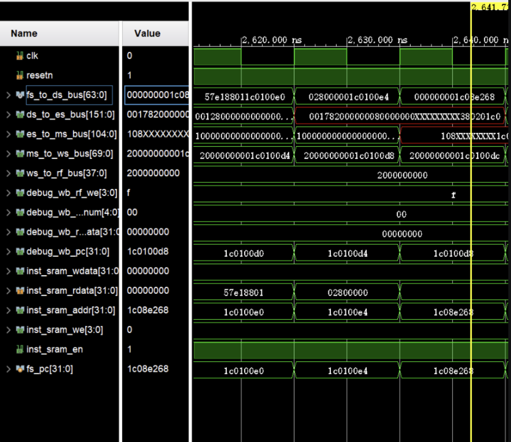

# 一些开发日志罢大抵
## 2026.9.13
### 进度
- 基本部署起来了开发环境，可以进行愉快的编程了。
### 补充说明
1. 测试文件的逻辑是检测debug_rf_we信号是否使能，即判断是否有写寄存器，所以不用区分单总线和单周期
2. 写入内存的操作不会被当周期直接发现，而是在载入寄存器时发现问题。
3. 缓冲区设计方法：根据上一级传进来的bus剔除掉在本阶段要使用的信号，添加下一阶段要使用的信号，其余全保留。
### 接下来要做的
1. 明确信号与模块框架   （已完成）
2. 使用一个好的文件夹管理   （已完成）

## 2026.9.14
### 进度
- 完成了基础框架的跑通，但pc恒为0，估计是中间信号有点问题，仍在调试
### 开发日志
1. MEM_stage中的中间端口没定义，还有一些位宽不对，进行调整
2. 遇到一个神必问题：由于reset触发后，fs_valid需要等一个周期才能有效，这导致此阶段的数据无法传到下一阶段。而指令取指与取指流水线管理员没有握手确认。此时下一个流水线的数据已经准备好，会覆盖第一条指令的缓冲区，或者可以说，传递的PC与其指令并不对应？
    - 先尝试把取指改为当前pc，这样第一个周期在覆盖后pc+4正好等于程序入口（完全胜利）
- 哦不不不，问题没这么简单。似乎是因为初始的pc负溢出被截断了。这似乎引来了新的问题，好像ip核大小不够放下整个文件啊
- 图片中显示这个地址传进去后访问出来的指令值是全0，计算后得知这个指令取指的范围大于了指令内存最大65536，而这个指令地址又是在inst_rim中真实存在的.
- 同时TCL在构建时发出警告
```bash
WARNING: Too many words specified in data file ../../../../../../../../func/obj/inst_ram.mif
```
- 解决方法是换个ip核，但也要更改ip核取指范围，同时顶层的soc_lite_top好像还缺少了inst_sram_en字段，遂补充

3. 更改后发现alu移位操作有一些操作数序号反了的问题，遂改正
### 接下来要做的
1. 跑通func1    (已完成)


## 2026.9.20
### lab2阻塞
1. 只需将ds_ready_go与后面三级流水线的写寄存器进行对比，如果是写指令且目标寄存器与自己的相同，则置为0
2. 此时需注意当上一级流水线没有传数据时，应将当前流水线寄存器中的值置为0
### lab2访存
1. 想实现一个流水线访存，所以需要对模块额外实例化一些握手信号
2. 因为根本忘记了取指是直接用next_pc取的，于是浪费了一上午在编写同步的握手信号上。晚上重新推翻重写后直接过了，轻松绷住
3. 呃呃呃，似乎inst_ram本身就是同步内存模块，所以手册中的逻辑是否应该改为组合逻辑（？
4. 哇，教材十分的强力且活人味啊，十分清晰。
### lab2前递
1. 目前只实现了load指令的延迟，以及普通运算指令的冲突处理，load系指令的延迟加载似乎要等到第四章(?)
2. 并非啊，dram是异步读，最大容量不能超过65536（vivado不支持直接生成大于65536的同步读ram）。bram是同步读，遂改成bram创建工程。因此似乎访存模块也不用实例化了

## 2026.9.23
### lab3指令
1. bl，似乎第一个要实现的指令是这个
2. 实际并非，其实是每次更换obj后还要重新生成一次inst_ram，否则inst_ram会存储原来的旧数据。但gettrace生成的golden_trace是新的
-  Reset Output Products + Generate Output Products
3. 添加算术逻辑运算类指令 slti、sltui、andi、ori、xori、sll、srl、sra、pcaddu12i(已达成)

#### blt
- 已实现